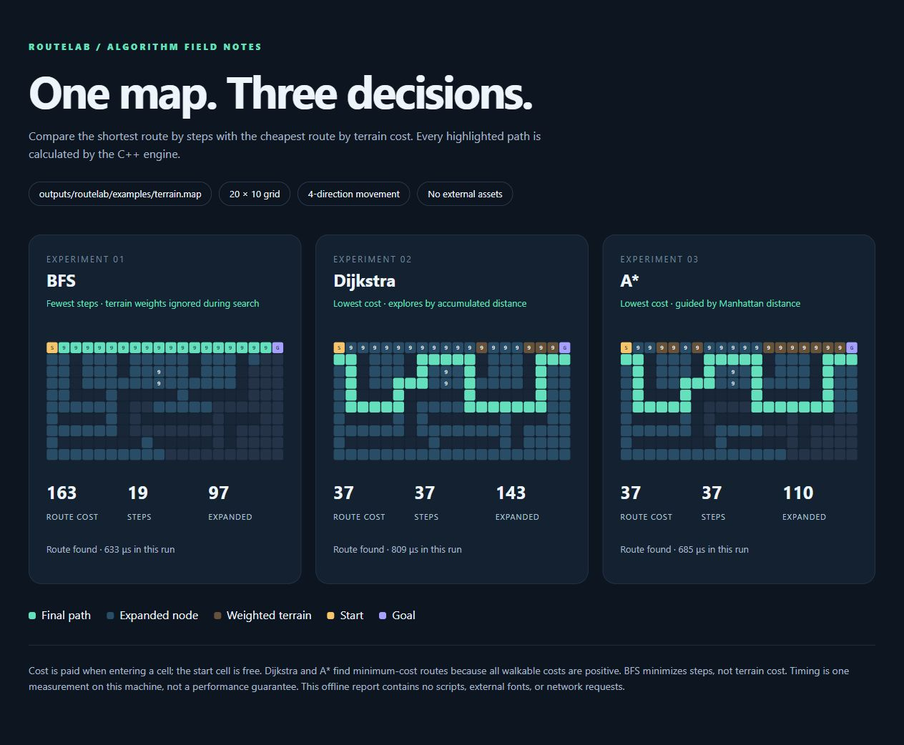

<div align="center">

# RouteLab
### One map. Three decisions.

**C++17 · BFS / Dijkstra / A* · Offline visual reports · Zero third-party libraries**

[Quick start](#quick-start) · [Map format](#map-format) · [Design notes](docs/DESIGN.md) · [Roadmap](docs/ROADMAP.md)

</div>



## Why this exists

A route with fewer steps is not always cheaper. RouteLab makes the difference visible: run three algorithms against the same weighted map and inspect their routes, costs and explored cells side by side.

The sample map makes BFS take a 19-step route costing **163**, while Dijkstra and A* take a 37-step route costing **37**. This is a small, reproducible experiment rather than a claim that one algorithm is always faster.

## What you can do

| Capability | Details |
| --- | --- |
| Compare routes | BFS minimizes steps; Dijkstra and A* minimize terrain cost |
| Inspect search work | Expanded cells, final path, step count, cost and measured runtime |
| Create experiments | Seeded map generation with a guaranteed reachable goal |
| Bring your own maps | A compact text format with walls and costs from 1 to 9 |
| Share a result | One standalone HTML file with inline SVG, no scripts or remote assets |
| Check the implementation | Fixed examples, malformed-input checks and 100 seeded-map tests |

## Quick start

Requires a **C++17 compiler**. No package manager or external libraries are needed.

### GCC / Clang

```sh
g++ -std=c++17 -O2 -Wall -Wextra -Iinclude src/main.cpp -o routelab
./routelab compare examples/terrain.map report.html
```

Open `report.html` in your browser. On Windows, run `./routelab.exe` instead.

### CMake

```sh
cmake -S . -B build
cmake --build build --config Release
ctest --test-dir build -C Release --output-on-failure
```

The executable is `build/routelab` with a single-configuration generator or `build/Release/routelab.exe` with Visual Studio.

### More experiments

```sh
./routelab solve examples/terrain.map astar
./routelab generate 20 30 42 generated.map
./routelab compare generated.map generated.html
./routelab compare examples/blocked.map blocked.html
```

Generation is reproducible for the same dimensions and seed. An unreachable goal is a valid experiment and is reported as such; malformed input exits with code 1.

## Map format

```text
S999G
.....
```

| Symbol | Meaning |
| --- | --- |
| `S` / `G` | Exactly one start and one goal |
| `#` | Impassable wall |
| `.` | Walkable cell with cost 1 |
| `1`–`9` | Cost to enter the cell |

Movement is up, right, down or left. The start costs zero. Maps must be rectangular, nonempty, and at most 100 × 100 cells. Generated maps must be at least 3 × 3. UTF-8 BOM and Windows line endings are accepted.

## How the algorithms differ

| Algorithm | Frontier | Objective | Complexity on this grid |
| --- | --- | --- | --- |
| BFS | FIFO queue | Fewest steps | O(V + E) |
| Dijkstra | Min-priority queue | Lowest total entry cost | O((V + E) log V) |
| A* | Min-priority queue + Manhattan heuristic | Lowest total entry cost | O((V + E) log V) worst case |

Manhattan distance is admissible here because every step costs at least 1 and diagonal movement is disabled. Equal-priority entries use insertion order for reproducible routes. Runtime measurements are single-run observations, not reliable benchmarks.

## Project layout

```text
include/routelab/
  grid.hpp       # parsing, neighbors and seeded generation
  search.hpp     # algorithms and path reconstruction
  report.hpp     # escaped HTML and inline SVG output
src/main.cpp     # command-line interface
tests/tests.cpp  # deterministic tests and algorithm invariants
examples/        # weighted and unreachable maps
docs/            # screenshots, design and roadmap
```

## Scope and next steps

RouteLab is an experiment runner, not a navigation service. It has no live map editor, diagonal movement or animated playback. The generator carves a guaranteed route and is not intended to generate perfect mazes. Reports overwrite the output path you supply. See the [roadmap](docs/ROADMAP.md) for scoped extensions.

## Development notes

Written from scratch with AI assistance. General inspiration came from public pathfinding visualizers; no source code, images or third-party libraries were copied into this project. See [provenance](docs/PROVENANCE.md). No license has been selected for this repository yet.
